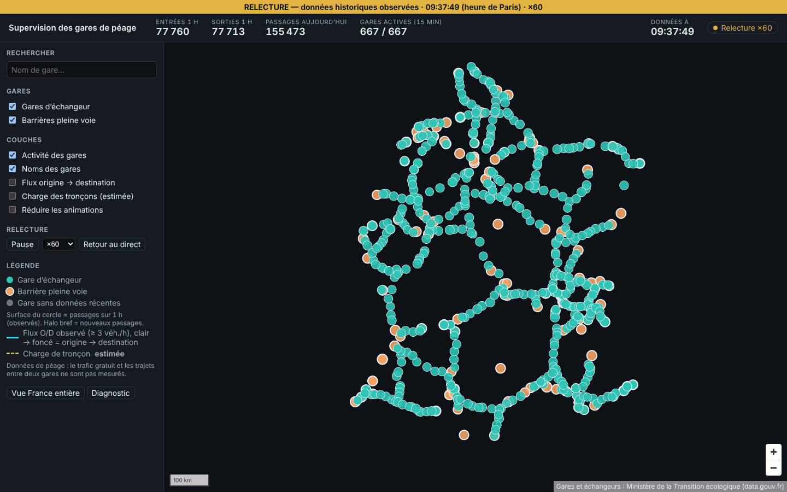

# Incrément 2 — Historique et relecture

> Historique OBSERVÉ persisté en plusieurs résolutions, comparaison avec J-7 dans le détail d'une gare, relecture accélérée de l'historique sur la carte.
> Critères de la roadmap (phase 3, section 10.2) : requête sur 13 mois < 1 s ; relecture fluide à ×60.

## 1. Principe : l'historique fait partie du point de reprise

L'écrivain unique accumule, pour chaque passage appliqué, un incrément (gare × minute, et O/D × heure / × jour civil de Paris).
À chaque point de reprise, **une seule transaction PostgreSQL** écrit :
1. les incréments d'historique, par upsert **additif** dans `station_minute`, `station_quarter`, `station_hour`, `od_hour` et `od_day` ;
2. les issues des rejeux de quarantaine (auparavant écrites tout de suite, hors transaction) ;
3. le point de reprise lui-même (état et offsets).

L'historique contient donc exactement ce que couvrent les offsets du point de reprise. Après un crash, les événements suivants sont rejoués et leurs incréments réécrits **une seule fois**. Si l'écriture échoue, le lot est réintégré au point de reprise suivant ; rien n'est perdu.

Conséquence assumée : l'historique a au plus un intervalle de point de reprise (60 s) de retard sur le temps réel.

## 2. Ce qui a été livré

| Brique | Contenu |
|---|---|
| Schéma (`V2__history.sql`) | 5 tables partitionnées par période (UTC ; date civile pour `od_day`). Clé primaire (gare, tranche) et index par tranche pour la relecture. |
| Partitions (`history/PartitionManager`) | Création à la demande dans la transaction (cache alimenté seulement après validation), préparation d'aujourd'hui et de demain au démarrage puis chaque nuit. **Purge par `DROP` de partition** selon la rétention : minute 7 j, quart d'heure 400 j, heure 1 100 j, O/D horaire 93 j, O/D journalier 400 j. |
| Écriture (`history/JdbcHistorySink`) | Lots `batchUpdate`. Quart d'heure et heure calculés à partir des minutes du lot : aucun recalcul planifié, pas d'écart possible entre résolutions. |
| API | `GET /api/v1/stations/{id}/history?from&to&step=PT1M\|PT15M\|PT1H` ; `GET /api/v1/history/network` ; `/history/minutes` (≤ 2 h, relecture) ; `/history/totals` (≤ 25 h) ; `/history/od` (seuil de diffusion d'au moins 3 véhicules imposé). Plages validées (400 si vide ou trop longue). Compression gzip pour JSON et GeoJSON, jamais pour le flux SSE. |
| Détail d'une gare | Courbe par quart d'heure depuis minuit (heure de Paris) : aujourd'hui en trait plein, même jour il y a 7 jours en tirets, avec les totaux. Rafraîchie chaque minute. Minuit calculé correctement les jours de changement d'heure (`parisMidnight`, testé). |
| **Relecture** | Panneau « Relecture » : début, durée (30 min à 6 h), vitesse (×1, ×10, ×60, ×300) ; lecture/pause, changement de vitesse sans saut, **retour au direct**. Les données sont chargées par tranches de 2 h, avec une heure de recul pour les fenêtres glissantes et une base « depuis minuit ». Elles sont organisées en sommes cumulées par gare, ce qui calcule chaque fenêtre en temps constant. Pendant la relecture, le flux temps réel est **suspendu** ; il reprend au retour par un snapshot. Bandeau ambre « RELECTURE — données historiques observées », état « Relecture ×N ». Flux O/D historiques rechargés tous les 15 min virtuelles. |

## 3. Vérifications

| Vérification | Résultat |
|---|---|
| Tests unitaires backend (dont accumulateur, fusion de lots, regroupement en quarts d'heure et heures, bornes de partitions, Modulith avec le nouveau module `history`) | ✅ 63 |
| Intégration (Kafka et PostgreSQL réels) : **historique = temps réel dans les trois résolutions** ; plages invalides → 400 ; seuil O/D ; purge d'une partition minute de 30 jours mais pas d'une partition quart d'heure | ✅ SupervisionIT (5) |
| **Redémarrage** : 140 passages (dont doublons rejoués) → `sum(entries + exits)` = **140** dans `station_minute`, `station_quarter` et `station_hour` | ✅ RestartRecoveryIT |
| Tests unitaires frontend (heure de Paris et changements d'heure, jeu de relecture, horloge virtuelle, chargement par tranches avec base depuis minuit) | ✅ 53 |
| E2E réels (backend + simulateur) : direct, latence, **relecture puis retour au direct**, **courbe aujourd'hui / J-7** | ✅ 4 (latence p50 = 1 s, p95 = 2 s) |
| E2E démonstration (régression corrigée, voir section 4) | ✅ 4 |
| **Performance** sur **25,6 M** lignes au quart d'heure (13 mois × 667 gares) et **17,6 M** lignes horaires (3 ans), jeu SYNTHÉTIQUE `scripts/perf_history.sh` | ✅ une gare sur 13 mois au pas de 15 min : **0,31 à 0,53 s** ; une gare sur 3 ans au pas horaire : 0,20 à 0,22 s ; réseau sur 30 jours au pas horaire : 0,14 à 0,19 s |
| **Relecture ×60** | ✅ 1 minute virtuelle par seconde réelle (09:30:36 → 09:31:36) ; 23 images/s, identique au mode direct dans le même environnement (rendu WebGL logiciel, valeur basse) |

## 4. Défauts trouvés et corrigés

- **Régression de la démonstration** : depuis la phase 3, `frontend/.env` porte les URL de tuiles de production, que `.env.demo` ne surchargeait pas. La démo tentait de charger des PMTiles absents. Les E2E de démonstration l'ont détecté via les erreurs console ; corrigé dans `.env.demo`.
- **Issues de rejeu de quarantaine écrites hors du point de reprise** (incrément 1) : un crash entre ces deux écritures pouvait marquer un événement « appliqué » sans que l'état le contienne. Ces issues passent désormais dans la transaction du point de reprise.
- **Tests interdépendants** : les tests d'intégration partageant l'application comparaient des totaux globaux. Chaque test travaille maintenant sur ses propres gares.
- Le nom accessible des listes déroulantes incluait la valeur choisie (« Vitesse ×60 ») : libellés explicites ajoutés (aussi meilleur pour les lecteurs d'écran).

## 5. Limites et suites

- **Relecture limitée aux 7 derniers jours**, la durée de rétention des minutes. Au-delà, il faudrait une relecture au quart d'heure (fenêtres de 5 min indisponibles) : à décider selon le besoin.
- Le volume `od_hour` reste à mesurer sur données réelles (hypothèse de la phase 2 : environ 480 000 lignes par jour). La purge à 93 jours le borne.
- Le mode relecture charge toute la période avant de jouer : environ 2 Mo compressés pour 6 h. Un chargement progressif est possible si des relectures plus longues sont demandées.
- Fluidité à mesurer sur le poste de référence (Q20) : les 23 images/s mesurées ici viennent d'un rendu WebGL logiciel.
- Toujours ouvertes : Q4 (volumétrie réelle), Q21 (accès réseau pour la chaîne cartographique).
