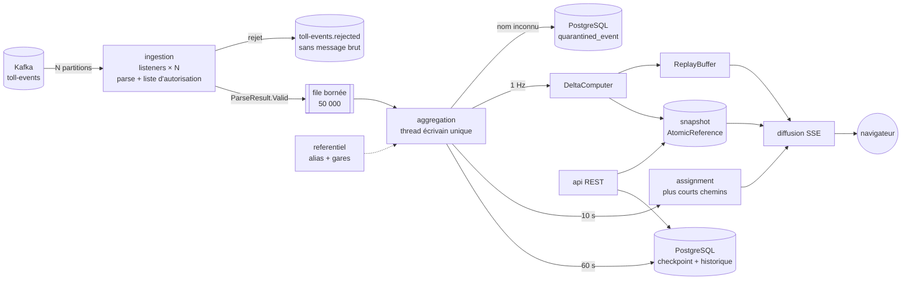
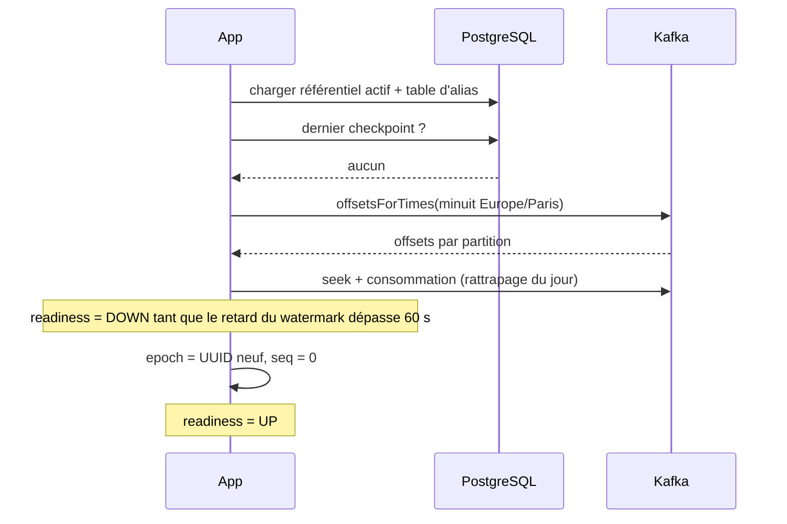
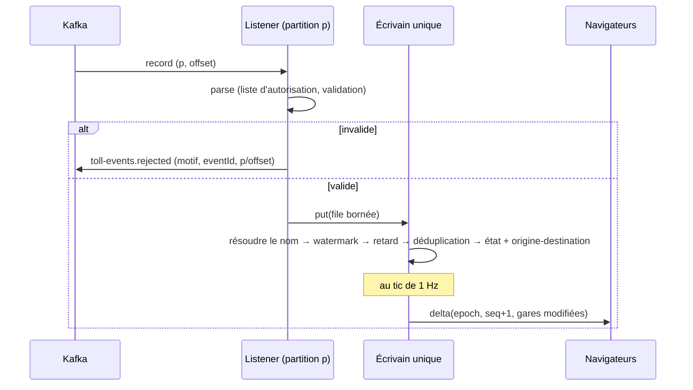
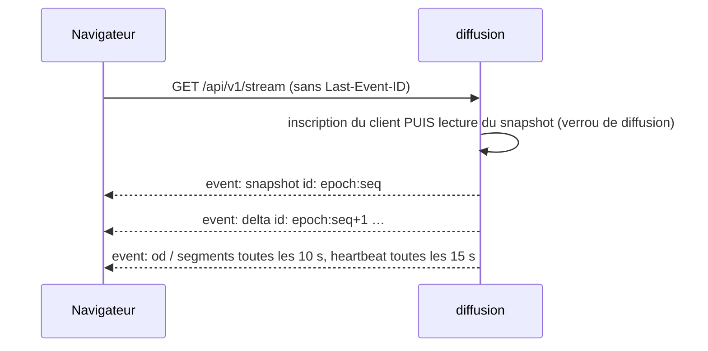
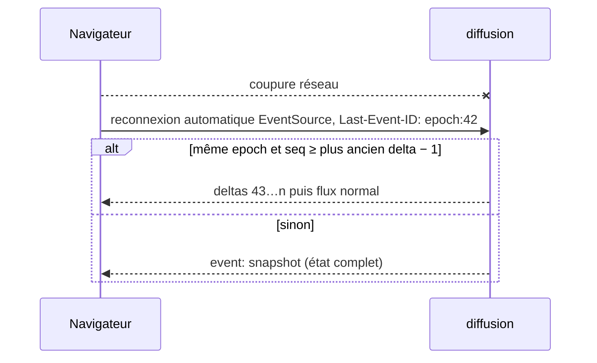
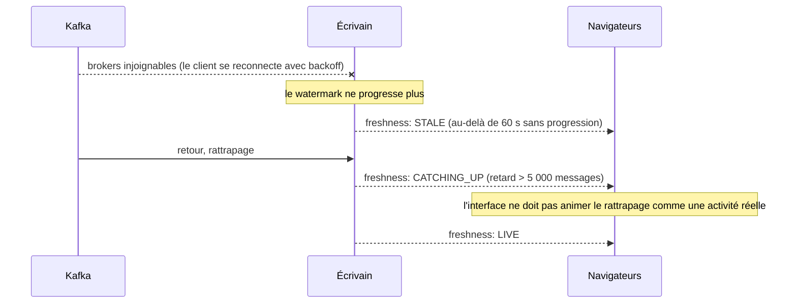
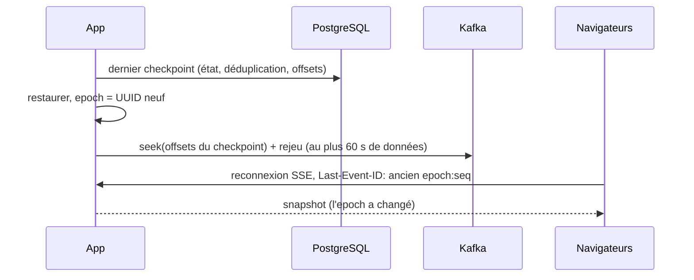
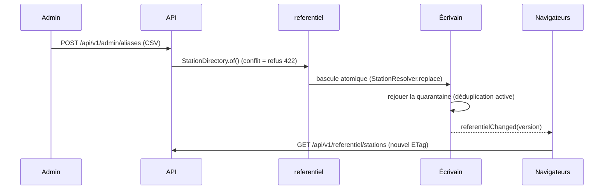

# Dossier d'architecture backend — Phase 2/3

> Produit à partir de `prompts/phase-2-architecture-temps-reel.md` et de `docs/phase-1-dossier-cadrage.md`.
> Code des points délicats : `backend/` (Spring Boot 4.1.1, Jackson 3). 43 tests passent : `mvn -Djava.version=21 test` sur un JDK 21 ; la cible est Java 25.

**Légende.** **[F]** fait, **[H]** hypothèse, **[D]** décision, **[Q]** question ouverte.

---

## 1. Synthèse et décisions structurantes

Réponses intégrées :
- **Q1** : les événements identifient la gare **par son nom** ;
- **Q2** : le message de sortie **porte la gare d'entrée**. On est donc en **scénario A** : les flux origine-destination sont observés et la charge des tronçons est estimée.

| # | Décision | Justification courte |
|---|---|---|
| D10 | **Monolithe modulaire** Spring Boot 4.1 + Spring Modulith 2.1, une seule instance active | 667 gares et ~300 évt/s en pointe (hypothèse) tiennent sur un seul cœur ; un seul état mémoire rend le snapshot cohérent sans coordination |
| D11 | Rapprochement par **table d'alias nom → gare logique**, versionnée et validée ; nom inconnu → **quarantaine**, jamais de rapprochement approximatif automatique | Q1. Une erreur d'appariement place des passages sur une mauvaise gare sans que personne le voie |
| D12 | **Agrégation dans l'application, écrivain unique** (un seul thread modifie l'état) plutôt que Kafka Streams | Volumétrie modeste ; pas de stockage RocksDB ni de topics internes à exploiter ; état reconstructible |
| D13 | **Idempotence** = déduplication par `eventId` sur un horizon de 2 h en temps d'événement + **points de reprise transactionnels** (état, offsets, déduplication et historique dans une seule transaction) | Le mode exactly-once de Kafka ne couvre ni l'état mémoire ni la diffusion |
| D14 | Retard toléré de 10 min pour l'affichage ; jusqu'à 2 h, l'événement devient une **correction** de l'historique ; au-delà, rejet `TOO_LATE` | Ne jamais compter un événement qu'on ne peut plus dédupliquer |
| D15 | Diffusion par **SSE** (et non WebSocket), avec `Last-Event-ID = epoch:seq` | Canal descendant seulement ; reprise native via `Last-Event-ID` ; passe les proxys ; plus simple que STOMP |
| D16 | **Deltas à 1 Hz**, seulement les gares qui ont changé ; flux origine-destination et charges des tronçons toutes les 10 s, en remplacement complet de la liste | Débit borné quel que soit le volume Kafka |
| D17 | **PostgreSQL 17** natif, partitionnement par date, Flyway, `JdbcClient`. **Pas de TimescaleDB** | Les fonctions utiles de TimescaleDB (agrégats continus, compression) sont sous licence TSL, non open source |
| D18 | Charge des tronçons **calculée à la demande** à partir de la matrice origine-destination et du graphe ; seules les données **observées** sont persistées | Une estimation se recalcule quand le graphe ou l'algorithme change ; aucune estimation n'est figée en base |
| D19 | Aucune donnée personnelle hors du parseur ; le topic de rejet ne contient **pas** le message brut | RGPD (décision D6 de la phase 1) |

---

## 2. Registre faits / hypothèses / décisions (mise à jour)

| # | Type | Énoncé | Statut / impact |
|---|---|---|---|
| H1 | ~~H~~ → **F** | Les événements portent un nom de gare, pas un code | Réponse à Q1 |
| H2 | ~~H~~ → **F** | La sortie porte la gare d'entrée | Réponse à Q2 : scénario A |
| H7 | ~~H~~ → **F** | Les noms des événements sont ceux de `gares-peage-2025.csv` (réponse à Q14) | Vérifié par `ReferentielNamesResolutionTest` : les 813 noms bruts sont résolus. La quarantaine ne capte plus que des gares nouvelles ou des erreurs de saisie |
| H8 | H | Le nom de la gare d'entrée suit la même nomenclature que la gare de sortie | Sinon, statut `ENTRY_UNKNOWN` et perte de flux origine-destination, mesurée par métrique |
| H9 | H | `entryTime` est présent sur les sorties | Optionnel ; sert à répartir la charge des tronçons sur la durée du trajet (incrément ultérieur) |
| H10 | H | Aucun nom n'est partagé par deux gares distinctes dans les événements | Vérifié sur le référentiel : 812 alias, aucun conflit **[F]**. Un homonyme futur est **refusé au chargement** de la table |
| H4 | H | 50 / 300 / 2 000 évt/s | Inchangé : à mesurer (Q4) |
| H6 | H | Clé de partition = nom de gare | Non bloquant : l'agrégation est commutative |
| D10 à D19 | D | Voir section 1 | — |

---

## 3. Vue d'ensemble (2.1)

### 3.1 Modules (Spring Modulith) **[D]**

| Module | Responsabilité | Peut dépendre de |
|---|---|---|
| `referentiel` | Gares logiques, points de péage, échangeurs, **table d'alias**, import et versions | — |
| `ingestion` | Consommation Kafka, parsing avec liste d'autorisation, rejets, quarantaine | `referentiel` (API) |
| `aggregation` | Écrivain unique : watermark, retard, déduplication, état par gare, matrice origine-destination, deltas, points de reprise | `referentiel`, `ingestion` (événements) |
| `assignment` | Graphe routier, plus courts chemins, charge **estimée** des tronçons | `aggregation` (flux), `referentiel` |
| `history` | Persistance des agrégats observés, corrections, requêtes de séries | `aggregation` (événements de vidage) |
| `diffusion` | SSE : snapshot, deltas, tampon de reprise, contre-pression | `aggregation`, `assignment` |
| `api` | REST : référentiel, snapshot, détail, historique, origine-destination, tronçons, diagnostic, administration | tous (API publiques seulement) |
| `diagnostic` | Fraîcheur, retard du consommateur, compteurs de rejet et de quarantaine | `ingestion`, `aggregation` |

Les dépendances sont vérifiées par `ApplicationModules.of(App.class).verify()` dans un test.

### 3.2 Composants



### 3.3 Trois formats à ne pas confondre **[D]**

| Format | Où | Contenu | Données personnelles |
|---|---|---|---|
| **Événement Kafka** | topic `toll-events` | Message brut de l'exploitant | Possibles |
| **Événement validé** (`TollEvent`) | mémoire, file, quarantaine | Champs autorisés du contrat 0.1 | Non |
| **Agrégat métier** | état mémoire, PostgreSQL | Compteurs gare × minute, origine-destination × tranche, état observé | Non |
| **Message navigateur** | SSE, REST | `StationMetrics`, `OdFlow` au-dessus du seuil, charges `ESTIMATED` | Non |

### 3.4 Diagrammes de séquence

**Démarrage à froid** (pas de point de reprise) :



**Flux nominal d'un événement** :



**Connexion d'un navigateur** :



**Perte de connexion du navigateur** :



**Coupure Kafka** :



**Redémarrage du backend** :



**Mise à jour du référentiel ou de la table d'alias** :



---

## 4. Ingestion Kafka (2.2)

### 4.1 Consommateur **[D]**

```yaml
spring:
  kafka:
    bootstrap-servers: ${KAFKA_BOOTSTRAP_SERVERS}
    consumer:
      group-id: autoroutes-supervision
      enable-auto-commit: false
      auto-offset-reset: none            # le positionnement initial est piloté par l'application (minuit ou checkpoint)
      isolation-level: read_committed    # ignore les transactions abandonnées des producteurs transactionnels
      max-poll-records: 500
      key-deserializer: org.apache.kafka.common.serialization.StringDeserializer
      value-deserializer: org.springframework.kafka.support.serializer.ErrorHandlingDeserializer
      properties:
        spring.deserializer.value.delegate.class: org.apache.kafka.common.serialization.StringDeserializer
    listener:
      ack-mode: batch                    # offsets commités pour la supervision du retard ; la reprise s'appuie sur le checkpoint
      concurrency: ${KAFKA_CONCURRENCY:3}  # ≤ nombre de partitions
    security:
      protocol: ${KAFKA_SECURITY_PROTOCOL:SASL_SSL}
```

- Le **parsing** se fait dans les threads de consommation (parallélisme par partition), avec `TollEventParser` (`backend/.../ingestion/TollEventParser.java`) qui ne lit que les champs autorisés.
- Le passage à l'écrivain unique se fait par une **file bornée** (`ArrayBlockingQueue`, 50 000 éléments, avec `put` bloquant). Contre-pression : si l'écrivain ralentit, la consommation ralentit, et les offsets restent dans Kafka. L'ordre par partition est conservé car chaque partition est traitée par un seul thread, qui insère dans l'ordre.
- L'enveloppe transmise à l'écrivain contient `(partition, offset, TollEvent)`. Les offsets traités sont mémorisés par l'écrivain pour le checkpoint.
- **Positionnement au démarrage** (`ConsumerSeekAware.onPartitionsAssigned`) : offsets du checkpoint s'il existe, sinon `offsetsForTimes(minuit Europe/Paris)`. **Prérequis : rétention du topic ≥ 48 h.** **[Q13]**

### 4.2 Validation et rejets **[F]** (code)

`TollEventParser` renvoie `ParseResult.Valid` ou `ParseResult.Rejected(eventId, reason, field)`. Motifs : `INVALID_JSON`, `MISSING_FIELD`, `INVALID_FIELD`, `FUTURE_EVENT_TIME` (plus de 5 min d'avance).

Un rejet est publié sur `toll-events.rejected` :
- **valeur nulle** ;
- en-têtes `x-reason`, `x-field`, `x-event-id`, `x-source-partition`, `x-source-offset`.

Le message brut reste consultable à sa position d'origine pendant la rétention du topic source, par les seules personnes habilitées. Un rejet ne bloque jamais la partition.

Contrat **0.1-draft**, mis à jour pour Q1/Q2 : `stationCode` devient **`stationName`** et `entryStationCode` devient **`entryStationName`**. Le reste est inchangé (phase 1, section 5).

### 4.3 Rapprochement par nom (Q1) **[D11]**

- **Normalisation** (`StationNames.normalize`) : décomposition Unicode, suppression des accents, minuscules, ponctuation remplacée par des espaces, espaces fusionnés. Elle couvre les cas réels du référentiel : `"\tGondreville la Franche"`, `Pont-Colbert BPV` / `Bpv`.
- **Table d'alias** (`referentiel/alias-gares.csv`, générée par `scripts/analyse_referentiel.py`) : **812 alias → 667 gares logiques**, chargée sans conflit (test `AliasTableIntegrityTest`) **[F]**. Plusieurs alias peuvent viser la même gare (`Bellegarde Entrée`, `Bellegarde Sortie`, `Bellegarde`).
- **Conflit** (un nom normalisé pointant vers deux gares) : la table est **refusée au chargement** (`StationDirectory.of` lève une exception). L'ancienne table reste active.
- **Nom inconnu** : l'événement va en **quarantaine** (`quarantined_event`, champs autorisés seulement, `eventId` en clé primaire). Une mise à jour de la table d'alias déclenche le **rejeu** de la quarantaine :
  - événement dans l'horizon de déduplication : il passe par la chaîne normale ;
  - événement plus ancien : il est ajouté à l'historique, et la ligne de quarantaine passe à `PROCESSED` **dans la même transaction**, ce qui garantit l'idempotence.
- **Aide à la saisie** : la vue diagnostic propose, pour chaque nom en quarantaine, les 3 alias les plus proches (distance de Levenshtein sur le nom normalisé). **Ces suggestions ne sont jamais appliquées automatiquement.**
- **Évolution possible** : si deux exploitants utilisent le même nom, la clé d'alias devient `(exploitant, nom)`. Le contrat prévoit déjà un champ `operator` optionnel.

### 4.4 Idempotence **[D13]**

`EventDeduplicator` (`backend/.../ingestion/EventDeduplicator.java`) :
- clé : les **64 premiers bits du SHA-256** de `eventId` (taille fixe ; probabilité de collision d'environ 1e-7 pour 2 millions d'identifiants) ;
- rangement par **minute d'`eventTime`**, purge quand `watermark − 2 h` dépasse la minute ;
- mémoire proportionnelle au débit × horizon : environ 100 Mo à 300 évt/s (signalé dans le code ; passer à un ensemble de `long` primitifs si la mesure l'exige) ;
- `export()` / `restore()` pour le checkpoint.

Cas couverts :

| Source de doublon | Mécanisme |
|---|---|
| Nouvel essai du producteur, republication en amont (< 2 h) | Déduplication |
| Rejeu du consommateur après un crash | Restauration du checkpoint puis rejeu exact des offsets suivants : rien n'est compté deux fois |
| Redistribution des partitions | Une seule instance active ; avec plusieurs, la déduplication suit l'état (voir section 4.6) |
| Doublon de plus de 2 h | Impossible à garantir : rejeté `TOO_LATE`, **jamais compté** |

Limite connue : un même `eventId` republié avec un `eventTime` différent n'est pas détecté (rangement par minute). Une métrique le révélerait si `eventId` est stable côté producteur. **[Q3]**

### 4.5 Ordre et événements tardifs **[D14]**

- Kafka ne garantit l'ordre qu'**au sein d'une partition**. L'agrégation est **commutative** (sommes par minute), donc l'ordre n'affecte pas les compteurs. Seuls le watermark et le classement des retards en dépendent.
- `WatermarkTracker` : minimum, sur les partitions **actives**, du plus grand `eventTime` vu. Une partition muette depuis plus de 30 s (horloge murale) est ignorée.
- `LatenessPolicy` :

| Retard par rapport au watermark | Verdict | Effet |
|---|---|---|
| ≤ 10 min | `ON_TIME` | État courant ; la minute sera vidée vers l'historique plus tard |
| 10 min à 2 h | `CORRECTION` | État courant + incrément de l'historique (upsert additif) ; métrique `late_events{verdict=correction}` |
| > 2 h | `TOO_LATE` | Rejet ; métrique |

- **Vidage vers l'historique** : une minute est figée quand `watermark > fin de la minute + 10 min`.

### 4.6 Évolution multi-instance **[H]**, hors périmètre du MVP

Si la mesure impose plusieurs instances, il faut :
1. partitionner l'état par gare (la clé Kafka doit alors être le nom de gare, Q3) ;
2. publier les deltas partiels dans un topic compacté interne `supervision.station-metrics` ;
3. faire lire ce topic par des instances de diffusion sans état.

Ce n'est **pas** nécessaire tant qu'un cœur absorbe la pointe mesurée : le banc de test (section 9) doit le vérifier.

### 4.7 Chemin critique et concurrence

- **Aucun verrou** sur l'état : seul l'écrivain y accède. Les lecteurs (REST, SSE) lisent des objets **immuables** : snapshot dans une `AtomicReference`, `Delta` sous forme de record avec listes immuables.
- Allocations par événement : un `TollEvent`, une enveloppe, une empreinte `Long`, un nœud de `HashSet`. Négligeable à 300 évt/s ; à surveiller à 2 000 évt/s (profilage avec JFR, scénario stress).
- `ReplayBuffer` est le seul objet partagé modifiable. Il est `synchronized`, avec un écrivain à 1 Hz et des lectures à la reconnexion : pas de contention.

---

## 5. Calcul des indicateurs (2.3)

### 5.1 Par gare logique (observés) **[F]** (code : `AggregationState`, `MinuteRing`)

- Compteurs **par minute** sur un **anneau de 25 h** (`MinuteRing.SIZE = 1500`), pour couvrir la journée de 25 h du passage à l'heure d'hiver (test `todayStartsAtParisMidnightAndCovers25HoursOnFallBackDay`).
- Fenêtres : 5 min, 15 min, 1 h glissantes, plus le **cumul du jour** depuis minuit à Paris. Toutes sont calculées à la **minute du watermark** : déterministe et rejouable.
- `StationMetrics(stationId, last5m, last15m, last1h, today, lastEventTime)` ; `WindowCounts(entries, exits)` avec `balance()`.
- Mémoire : 667 gares × 3 × 1 500 × 8 o ≈ **24 Mo** **[F]** (calcul).
- **Fraîcheur par gare** (`diagnostic`) : l'intervalle attendu est la médiane des écarts entre événements sur la même tranche horaire de la semaine précédente. Statut `STALE` au-delà de 5 fois cet intervalle, avec un minimum de 10 min. Au MVP, sans historique : seuil fixe de 15 min.

### 5.2 Indicateurs globaux et par axe

- Calculés au tic (1 Hz) comme somme des `StationMetrics` publiés : un simple passage sur 667 gares.
- Par axe : rattachement gare → axe du référentiel (phase 1, section 4.3).

### 5.3 Matrice origine-destination (observée, Q2) **[F]** (code : `OdCounters`)

- Comptage **par tranche de 15 min de l'heure de sortie**, en mémoire creuse (seuls les couples observés), avec une rétention de 25 h.
- Statut d'une sortie (`EventProcessor.OdStatus`) :
  - `RECORDED` : flux enregistré ;
  - `ENTRY_MISSING` : système ouvert ou champ absent ;
  - `ENTRY_UNKNOWN` : nom d'entrée inconnu. Le passage est compté pour la gare, mais aucun flux n'est inventé.
- **Seuil de diffusion** : un couple n'est diffusé que s'il atteint ≥ 3 véhicules sur la fenêtre (paramétrable) ; la liste est limitée aux N premiers (500 par défaut).
- **Contrôle de cohérence** (critère de l'incrément 3 de la phase 1) : sur une fenêtre, Σ flux enregistrés = sorties − `ENTRY_MISSING` − `ENTRY_UNKNOWN`. C'est exposé dans le diagnostic.

### 5.4 Charge estimée des tronçons **[D18]** (module `assignment`)

| Élément | Choix |
|---|---|
| Graphe | Produit par la chaîne cartographique de la phase 3 (OSM `motorway` + `motorway_link`, concédé et non concédé), versionné (`graph-<date>.json`) : nœuds = jonctions, arêtes = tronçons (id, longueur, vitesse maximale) |
| Raccordement des gares | Chaque gare logique est rattachée au nœud le plus proche de son axe (contrôle : < 500 m) |
| Algorithme | **Tout-ou-rien au plus court chemin en temps** (longueur / vitesse ; 130 km/h par défaut), avec **JGraphT** (EPL-2.0 / LGPL-2.1) |
| Coût | Chemins **mis en cache par couple observé** (LRU borné à 100 000) ; à chaque tic de 10 s : Σ flux × appartenance au chemin, soit environ 20 000 couples × 30 arêtes = 600 000 additions |
| Étiquetage | Chaque charge porte `nature: "ESTIMATED"`, la version du graphe et celle de l'algorithme |
| Biais documentés | (1) Le flux est imputé à la fenêtre de **sortie**, donc décalé de la durée du trajet. (2) Les itinéraires alternatifs ne sont pas pris en compte, ce qui est approximatif en zone maillée (Île-de-France, Lyon). (3) Les trajets sans péage sont invisibles. |
| Évolution | Si `entryTime` est présent (H9), répartir le flux uniformément sur [entrée, sortie] le long du chemin. Cela reste une estimation, mieux répartie dans le temps. |

Rien de tout cela n'est persisté : la charge se recalcule à partir de `od_hour` et du graphe (D18).

### 5.5 Application dans l'application ou Kafka Streams **[D12]**

| Critère | Écrivain unique dans l'application (retenu) | Kafka Streams |
|---|---|---|
| Exactly-once | Checkpoint transactionnel + déduplication | Natif pour l'état ; la diffusion SSE reste hors périmètre |
| Exploitation | Une application et PostgreSQL | Topics internes (changelog, repartition), RocksDB, rééquilibrages |
| Snapshot cohérent | Immédiat (un seul état) | Interactive Queries réparties |
| Montée en charge | Verticale, puis section 4.6 | Horizontale native |
| Seuil de bascule | Pointe mesurée > 50 % d'un cœur pour l'écrivain, ou plus de 10 000 gares | — |

---

## 6. Persistance et reprise (2.4)

### 6.1 Schéma (Flyway `V1__init.sql`) **[D17]**

| Table | Contenu | Partitionnement / rétention |
|---|---|---|
| `referential_version` | version, date d'import, SHA-256 du fichier, rapport (jsonb), indicateur actif | — |
| `station_logical` | id, nom, type, axes, échangeur, département, lon/lat, nombre de voies, version | — |
| `toll_point` | id, `station_id`, route, pr, abs, cote, lon/lat, nom d'origine, voies, version | — |
| `station_alias` | nom normalisé (PK), nom, `station_id`, version | — |
| `station_minute` | `station_id`, minute (timestamptz), entrées, sorties | partition **quotidienne**, **7 jours** |
| `station_quarter` | idem, 15 min | partition mensuelle, **13 mois** |
| `station_hour` | idem, 1 h | partition annuelle, **3 ans** |
| `od_hour` | origine, destination, heure, véhicules | partition mensuelle, **3 mois** |
| `od_day` | origine, destination, jour, véhicules | partition annuelle, **13 mois** |
| `quarantined_event` | `event_id` (PK), champs autorisés, `received_at`, statut, `processed_at` | purge des `PROCESSED` au-delà de 30 jours |
| `checkpoint` | id, `created_at`, epoch, offsets (jsonb), état (bytea gzip), déduplication (bytea gzip) | les 3 derniers sont conservés |

- **Écriture** : au vidage, upsert **additif** (`ON CONFLICT … DO UPDATE SET entries = t.entries + EXCLUDED.entries`) dans les trois résolutions **dans la même transaction**. Pas de recalcul planifié.
- **Volumes** (667 gares) **[F]** (calcul) : minute ≈ 960 000 lignes/jour, soit 6,7 M sur 7 jours ; quart d'heure ≈ 25 M sur 13 mois ; heure ≈ 17,5 M sur 3 ans.
- **Origine-destination** **[H]** : avec ~20 000 couples actifs par heure, ≈ 480 000 lignes/jour, soit 43 M sur 3 mois. À mesurer : c'est le poste dominant.
- **Purge** : `DROP PARTITION` planifié (job `@Scheduled` + verrou consultatif PostgreSQL), sans `DELETE` massif.
- **PostGIS n'est pas nécessaire** côté backend : les points sont en lon/lat, la géométrie est gérée par la chaîne cartographique (phase 3).

### 6.2 Point de reprise **[D13]**

Toutes les 60 s (paramétrable), sur l'écrivain :
1. copier l'état (`MinuteRing` non vides, `OdCounters`, `EventDeduplicator.export()`, offsets traités par partition) en quelques millisecondes ;
2. dans un thread dédié, ouvrir **une transaction** qui :
   - écrit les minutes vidées et les corrections accumulées depuis le checkpoint précédent ;
   - écrit le checkpoint ;
   - valide.

Conséquence : après un crash, on recharge le checkpoint N−1 et on rejoue depuis ses offsets. Les vidages de la transaction N n'ont jamais été validés, donc **rien n'est compté deux fois** dans l'historique.

Taille : état gzip de quelques Mo ; déduplication jusqu'à ~17 Mo en pointe (2,2 M × 8 o) avant compression. **À mesurer** ; si c'est trop coûteux, passer le checkpoint à 5 min, ce qui allonge d'autant le rejeu.

### 6.3 Comportement visible pendant la reprise

| Phase | Readiness | Message de fraîcheur |
|---|---|---|
| Restauration + rejeu | `DOWN` (le répartiteur de charge ne route pas) | — |
| Retard du watermark < 60 s | `UP` | `LIVE` |
| Retard du consommateur > 5 000 messages après une coupure | `UP` | `CATCHING_UP` : l'interface fige les animations d'activité (phase 3) |

---

## 7. API REST (2.5)

Base `/api/v1`, JSON, OpenAPI généré par **springdoc-openapi** (Apache-2.0). Compression gzip. `ETag` sur les ressources du référentiel.

| Méthode | Chemin | Rôle | Réponse / remarques |
|---|---|---|---|
| GET | `/referentiel/stations` | VIEWER | Gares logiques (GeoJSON `FeatureCollection`), `ETag` = version |
| GET | `/referentiel/points` | VIEWER | Points de péage (GeoJSON) |
| GET | `/referentiel/interchanges` | VIEWER | Échangeurs (GeoJSON, bifurcations fusionnées) |
| GET | `/snapshot` | VIEWER | `Snapshot` (epoch, seq, watermark, stations), pour le débogage ou un client sans SSE |
| GET | `/stations/{id}` | VIEWER | `StationMetrics` + série par minute sur 24 h + statut de fraîcheur |
| GET | `/stations/{id}/history?from&to&step=PT15M` | VIEWER | Série observée ; `step` ∈ {PT1M (≤ 7 j), PT15M (≤ 13 mois), PT1H} ; 400 si incohérent |
| GET | `/od?window=PT1H&limit=500` | VIEWER | `OdFlow[]` au-dessus du seuil, `nature: OBSERVED` |
| GET | `/od/history?from&to&origin&destination` | VIEWER | Série `od_hour` / `od_day` |
| GET | `/segments/load?window=PT1H` | VIEWER | Charges `nature: ESTIMATED`, `graphVersion`, `algorithm` |
| GET | `/diagnostic` | VIEWER | Retard du consommateur, retard du watermark, rejets par motif, quarantaine (top noms + suggestions), doublons, retards, `OdStatus` |
| GET | `/stream` | VIEWER | SSE (section 8) |
| POST | `/admin/referentiel` | ADMIN | Multipart (CSV gares + échangeurs) → 202 + rapport d'import ; 422 si invalide |
| POST | `/admin/aliases` | ADMIN | CSV d'alias → 200 (nouvelle version) ; 422 en cas de conflit (détail) |
| POST | `/admin/quarantine/replay` | ADMIN | Rejeu manuel → 202 |

Pagination : seule `od/history` peut être volumineuse ; elle est paginée par curseur (`after=<heure>`). Versionnement : préfixe `/v1` ; tout changement incompatible passe en `/v2`.

---

## 8. Protocole temps réel (2.6)

### 8.1 SSE plutôt que WebSocket **[D15]**

| Critère | SSE | WebSocket (STOMP) |
|---|---|---|
| Sens | Serveur → client : suffisant (les filtres sont des paramètres de connexion, la resynchronisation est une reconnexion) | Bidirectionnel, non nécessaire |
| Reprise | **`Last-Event-ID` natif**, reconnexion automatique du navigateur | À implémenter |
| Proxys / HTTP/2 | HTTP standard, multiplexé en HTTP/2 | Mécanisme d'upgrade, parfois bloqué |
| Authentification | Cookie de session (même origine) | Idem |
| Limite | 6 connexions par domaine en HTTP/1.1 : **HTTP/2 obligatoire** devant les navigateurs | — |

Mise en œuvre : Spring MVC `SseEmitter` + **threads virtuels** (`spring.threads.virtual.enabled=true`). Chaque client a une **file bornée de 64 messages**, vidée par son thread virtuel. Un message est sérialisé **une fois** puis écrit vers tous les clients.

### 8.2 Messages

Tous les messages partagent la même enveloppe :

```json
{
  "$schema": "https://json-schema.org/draft/2020-12/schema",
  "$id": "urn:autoroutes:stream-message:1",
  "type": "object",
  "required": ["type", "epoch", "sentAt"],
  "properties": {
    "type":  { "enum": ["snapshot", "delta", "od", "segments", "freshness", "heartbeat", "resync", "referentielChanged"] },
    "epoch": { "type": "string", "format": "uuid" },
    "seq":   { "type": "integer", "minimum": 0, "description": "Présent sur snapshot et delta uniquement" },
    "sentAt":    { "type": "string", "format": "date-time" },
    "watermark": { "type": ["string", "null"], "format": "date-time" },
    "payload":   { "type": "object" }
  },
  "$defs": {
    "windowCounts": { "type": "object", "required": ["entries", "exits"],
      "properties": { "entries": { "type": "integer" }, "exits": { "type": "integer" } } },
    "stationMetrics": { "type": "object",
      "required": ["stationId", "last5m", "last15m", "last1h", "today"],
      "properties": {
        "stationId": { "type": "string" },
        "last5m":  { "$ref": "#/$defs/windowCounts" },
        "last15m": { "$ref": "#/$defs/windowCounts" },
        "last1h":  { "$ref": "#/$defs/windowCounts" },
        "today":   { "$ref": "#/$defs/windowCounts" },
        "lastEventTime": { "type": ["string", "null"], "format": "date-time" } } }
  }
}
```

| `type` | Champ SSE `id` | Fréquence | `payload` |
|---|---|---|---|
| `snapshot` | `epoch:seq` | à la connexion ou à la resynchronisation | `{ stations: stationMetrics[], referentielVersion }` |
| `delta` | `epoch:seq` | ≤ 1 Hz, seulement s'il y a un changement | `{ stations: stationMetrics[] }` |
| `od` | — | 10 s | `{ window: "PT1H", nature: "OBSERVED", minVehicles: 3, flows: [{originId, destinationId, vehicles}] }`, liste complète remplaçante |
| `segments` | — | 10 s | `{ window, nature: "ESTIMATED", graphVersion, algorithm, loads: [{segmentId, vehicles}] }` |
| `freshness` | — | à chaque changement + 10 s | `{ status: LIVE \| CATCHING_UP \| STALE, consumerLag, watermarkLagSeconds, staleStations: [id] }` |
| `heartbeat` | — | 15 s | `{}` (garde les proxys ouverts, détecte les coupures) |
| `resync` | — | file du client saturée | `{ reason }`, puis fermeture : le client se reconnecte et reçoit un snapshot |
| `referentielChanged` | — | après un import | `{ version }` : le client recharge `/referentiel/*` |

### 8.3 Règles de synchronisation

1. **Ordre garanti** : le snapshot envoyé à la connexion porte `seq = s`. Le client applique ensuite `s+1`, `s+2`… L'inscription au flux et la lecture du snapshot se font sous le même verrou de diffusion : aucun delta n'est perdu entre les deux.
2. **Trou détecté** (`seq` reçu ≠ dernier + 1) ou **changement d'epoch** : le client ferme et rouvre le flux sans `Last-Event-ID`, et reçoit un snapshot.
3. **Reprise** : `ReplayBuffer` conserve les **300 derniers deltas** (5 min à 1 Hz). `after(epoch, seq)` renvoie les deltas manquants, ou une valeur vide (snapshot) si l'epoch diffère ou si la séquence est sortie du tampon (code testé).
4. **Taille** : un delta fait au plus 667 × ~200 o ≈ 130 Ko (au changement de minute). Plafond de 512 Ko par message ; au-delà (scénario stress à 2 000 gares), on envoie un `snapshot` à la place du delta. La compression gzip des flux SSE n'est pas activée par défaut (risque de mise en tampon).
5. **Aucun filtrage côté serveur au MVP** : tous les clients reçoivent le même flux, sérialisé une seule fois. Un filtrage par zone ne se justifie qu'au-delà de quelques milliers de gares.
6. **Pas de connexion Kafka depuis le navigateur, aucun événement brut, aucune donnée personnelle** (D19).

### 8.4 Contre-pression et reconnexion

- File du client pleine (client lent, onglet en arrière-plan) : envoi de `resync`, fermeture, métrique `sse.dropped`.
- Côté client (phase 3) : `EventSource` gère la reconnexion. En cas d'échecs répétés, backoff exponentiel avec aléa (1 s → 30 s), géré par l'application.
- Limites : **500 connexions** au total et **5 par utilisateur**. Au-delà : 429.

---

## 9. Sécurité et exploitation (2.7)

| Sujet | Décision |
|---|---|
| Configuration | `application.yaml` + variables d'environnement ; `spring.config.import=optional:configtree:/run/secrets/` pour les secrets Docker / Kubernetes |
| Kafka | `SASL_SSL` + SCRAM-SHA-512, magasin de confiance monté ; ACL : lecture sur `toll-events`, écriture sur `toll-events.rejected` |
| Authentification | **OIDC** avec **Keycloak** (Apache-2.0) : `spring-boot-starter-oauth2-client`, connexion côté serveur, cookie de session `SameSite=Strict` (compatible `EventSource`) ; rôles `VIEWER`, `ADMIN` ; CSRF actif sur `/admin/**`. Profil `demo` sans authentification (réponse à Q12) |
| Limitation | Connexions SSE (section 8.4) ; débit REST au proxy inverse (Caddy ou nginx) ; taille maximale d'upload de 20 Mo |
| Journaux | JSON structuré (journalisation structurée native de Spring Boot, format `ecs`). **Jamais** de message brut ni de champ hors liste d'autorisation |
| Métriques (Micrometer → Prometheus) | `toll_events_total{result=valid\|rejected\|quarantined\|duplicate\|too_late}`, `toll_events_rejected_total{reason}`, `toll_od_total{status}`, `toll_late_events_total{verdict}`, `toll_watermark_lag_seconds`, `kafka_consumer_fetch_manager_records_lag_max`, `toll_writer_queue_size`, `toll_delta_bytes`, `sse_clients`, `sse_dropped_total`, `checkpoint_duration_seconds`, `checkpoint_bytes`, `dedup_entries` |
| Santé | Actuator `liveness` (processus) ; `readiness` = référentiel chargé + checkpoint restauré + retard du watermark < 60 s ; groupe `kafka` séparé (supervision, n'influe pas sur la readiness) |
| Alertes | Retard du watermark > 60 s ; retard du consommateur croissant pendant 5 min ; taux de quarantaine > 1 % ; `ENTRY_UNKNOWN` > 2 % des sorties ; checkpoint en échec ; file de l'écrivain > 80 % |
| Données périmées | Global : `STALE` si le watermark ne progresse plus depuis 60 s. Par gare : section 5.1. Le statut est propagé dans `freshness` et `/diagnostic` |

---

## 10. Arborescence et tests (2.8)

### 10.1 Arborescence

Légende : ✅ = implémenté et testé dans ce dépôt.

```
backend/
├── pom.xml                                   (Spring Boot 4.1.1, Java 25)
└── src/
    ├── main/java/fr/autoroutes/supervision/
    │   ├── SupervisionApplication.java
    │   ├── referentiel/
    │   │   ├── StationNames.java              ✅ normalisation
    │   │   ├── StationAlias.java              ✅
    │   │   ├── StationDirectory.java          ✅ table immuable, refus des conflits
    │   │   ├── StationResolver.java           ✅ bascule à chaud
    │   │   ├── ReferentielImporter.java       import CSV, Lambert 93 → WGS84 (proj4j, Apache-2.0), rapport
    │   │   └── ReferentielRepository.java
    │   ├── ingestion/
    │   │   ├── TollEvent.java, EventType.java ✅
    │   │   ├── TollEventParser.java           ✅ liste d'autorisation, rejets
    │   │   ├── ParseResult.java, RejectReason.java ✅
    │   │   ├── EventDeduplicator.java         ✅
    │   │   ├── TollEventListener.java         @KafkaListener → file de l'écrivain
    │   │   ├── RejectionPublisher.java        topic de rejet sans message brut
    │   │   └── QuarantineRepository.java
    │   ├── aggregation/
    │   │   ├── WatermarkTracker.java          ✅
    │   │   ├── LatenessPolicy.java            ✅
    │   │   ├── MinuteRing.java, AggregationState.java ✅
    │   │   ├── StationMetrics.java, WindowCounts.java ✅
    │   │   ├── OdCounters.java, OdFlow.java   ✅
    │   │   ├── EventProcessor.java            ✅ chaîne de traitement
    │   │   ├── DeltaComputer.java, Delta.java, Snapshot.java ✅
    │   │   ├── ReplayBuffer.java              ✅
    │   │   ├── AggregationWriter.java         boucle de l'écrivain unique (file, tics 1 s / 10 s / 60 s)
    │   │   └── CheckpointService.java
    │   ├── assignment/
    │   │   ├── RoadGraph.java                 chargement du graphe versionné
    │   │   └── SegmentLoadEstimator.java      JGraphT, cache LRU des chemins
    │   ├── history/
    │   │   ├── HistoryWriter.java             upserts additifs multi-résolution
    │   │   └── HistoryQueries.java
    │   ├── diffusion/
    │   │   ├── StreamController.java          GET /api/v1/stream
    │   │   ├── Broadcaster.java               sérialisation unique, files par client
    │   │   └── ClientChannel.java
    │   ├── api/                               contrôleurs REST
    │   └── diagnostic/                        fraîcheur, suggestions d'alias
    ├── main/resources/
    │   ├── application.yaml
    │   └── db/migration/V1__init.sql
    └── test/java/fr/autoroutes/supervision/   ✅ 43 tests unitaires (voir 10.2)
simulator/                                      générateur d'événements (module Maven séparé)
```

### 10.2 Plan de tests

| Niveau | Contenu | Outils | État |
|---|---|---|---|
| Unitaires | Normalisation, conflits d'alias, intégrité de la table du dépôt ; parseur (13 cas dont heure ambiguë, champs interdits ignorés) ; déduplication (horizon, purge, export/restauration) ; watermark (partition muette) ; retards ; fenêtres glissantes, journée de 25 h ; origine-destination avec seuil ; deltas (séquence contiguë, changement de minute, snapshot = dernier delta) ; tampon de reprise ; chaîne complète avec doublon, quarantaine, `ENTRY_UNKNOWN`, correction, `TOO_LATE` (Mockito) | JUnit 6, AssertJ, Mockito | ✅ **43 tests** |
| Propriétés | Commutativité (l'ordre des événements ne change pas les compteurs) ; idempotence (N rejeux = 1) ; Σ fenêtres = Σ événements appliqués ; Σ flux O/D + `ENTRY_MISSING` + `ENTRY_UNKNOWN` = sorties | jqwik (EPL-2.0) | à faire |
| Architecture | Dépendances entre modules | Spring Modulith `verify()` | à faire |
| Contrat | Exemples réels (Q3) validés contre le schéma 0.1 ; régression si le schéma évolue | JSON Schema Validator (Apache-2.0) | bloqué par Q3 |
| Intégration | Kafka KRaft + PostgreSQL : bout en bout ; **crash pendant le checkpoint puis reprise sans double comptage** ; coupure Kafka (`pause` du conteneur) → `STALE` → `CATCHING_UP` → `LIVE` ; reprise SSE par `Last-Event-ID` ; snapshot après changement d'epoch ; rejeu de quarantaine | Testcontainers 2 (MIT) | à faire (Docker requis) |
| Charge | Scénarios 50 / 300 / 2 000 évt/s, 10 / 50 / 500 clients SSE ; mesures : CPU de l'écrivain, file, latence Kafka → SSE (95e centile), mémoire de déduplication, taille du checkpoint | simulateur + Gatling (Apache-2.0) + JFR | à faire |

### 10.3 Générateur d'événements synthétiques (`simulator/`)

- Spring Boot + producteur Kafka idempotent ; toujours `simulated: true`.
- Noms tirés de `referentiel/alias-gares.csv`. Origines-destinations selon un **modèle gravitaire** (poids = `nbVoies`, décroissance avec la distance), barrières pleine voie en système ouvert (`entryStationName` absent).
- Paramètres : débit de base, profil journalier (pointes à 8 h et 18 h, vendredi de départs), et taux de doublons, retards (distribution), messages invalides, noms inconnus, entrées inconnues, avance d'horloge.
- Mode **rejeu déterministe** (graine fixe) pour les tests de non-régression.

---

## 11. Licences de la pile backend

| Composant | Rôle | Licence | Alternative |
|---|---|---|---|
| Spring Boot 4.1, Spring for Apache Kafka 4.1, Spring Modulith 2.1 | Socle | Apache-2.0 | Quarkus |
| Apache Kafka client 4.2 | Consommation | Apache-2.0 | — |
| Jackson 3.1 | JSON | Apache-2.0 | — |
| PostgreSQL 17 / pilote JDBC | Persistance | PostgreSQL License / BSD-2 | — |
| Flyway 12 (édition communautaire) | Migrations | Apache-2.0 | Liquibase (Apache-2.0) |
| JGraphT | Plus courts chemins | EPL-2.0 / LGPL-2.1 | GraphHopper (Apache-2.0, plus lourd) |
| proj4j | Lambert 93 → WGS84 | Apache-2.0 | GeoTools (LGPL) |
| Micrometer / Prometheus | Métriques | Apache-2.0 | — |
| Keycloak | OIDC | Apache-2.0 | Authentik |
| springdoc-openapi | Documentation de l'API | Apache-2.0 | — |
| JUnit 6 / Mockito / AssertJ / jqwik / Testcontainers / Gatling | Tests | EPL-2.0 / MIT / Apache-2.0 / EPL-2.0 / MIT / Apache-2.0 | — |
| ~~TimescaleDB~~ | — | Apache-2.0 pour le cœur, **TSL** pour les fonctions utiles : écarté | PostgreSQL natif partitionné |

---

## 12. Risques et questions ouvertes

| # | Risque / question | Impact | Mesure |
|---|---|---|---|
| R1 | ~~H7 : noms des événements ≠ noms du référentiel~~ | Levé | Q14 : même liste de gares que le référentiel ; test de non-régression à chaque mise à jour du référentiel |
| R2 | Homonymes futurs entre exploitants | Table refusée au chargement | Clé `(exploitant, nom)` (section 4.3) |
| R3 | Une seule instance = point de défaillance unique | Indisponibilité de 1 à 2 min au redémarrage | Redémarrage automatique + reprise rapide ; section 4.6 si le SLA l'exige (Q15) |
| R4 | Mémoire de déduplication en pointe réelle | Pression sur le GC | Mesure au banc ; ensemble de `long` primitifs ; réduire l'horizon |
| R5 | Volume `od_hour` | Stockage | Mesure ; rétention de 3 mois déjà réduite |
| R6 | Acceptation métier de l'affectation tout-ou-rien | Contestation des charges estimées | Étiquette `ESTIMATED` systématique ; validation sur 3 axes (phase 1, incrément 4) |
| R7 | Maturité de Spring Boot 4 / Jackson 3 (changements de paquets `tools.jackson`) | Bibliothèques tierces incompatibles | Vérifié : le noyau compile et passe les tests avec Boot 4.1.1 ; dépendances tierces limitées |
| Q3 | Exemples réels, topics, partitions, clé, Schema Registry | Contrat, ordre | Toujours ouverte |
| Q4 | Volumétrie réelle | Dimensionnement | Toujours ouverte |
| Q13 | Rétention du topic ≥ 48 h ? | Démarrage à froid (rattrapage depuis minuit) | Nouvelle |
| Q14 | ~~Liste des noms de gare distincts présents dans le topic~~ | — | **Répondue** : même liste que `gares-peage-2025.csv` |
| Q15 | Disponibilité attendue (SLA) | Mono-instance ou section 4.6 | Nouvelle |
| Q16 | `entryTime` présent sur les sorties ? | Répartition temporelle des charges | Nouvelle |
