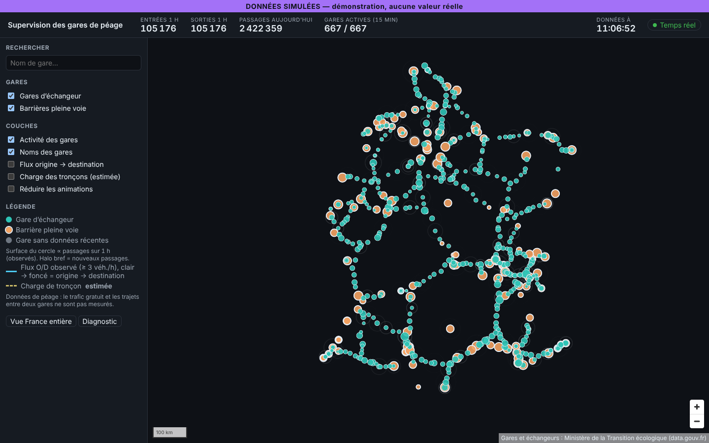
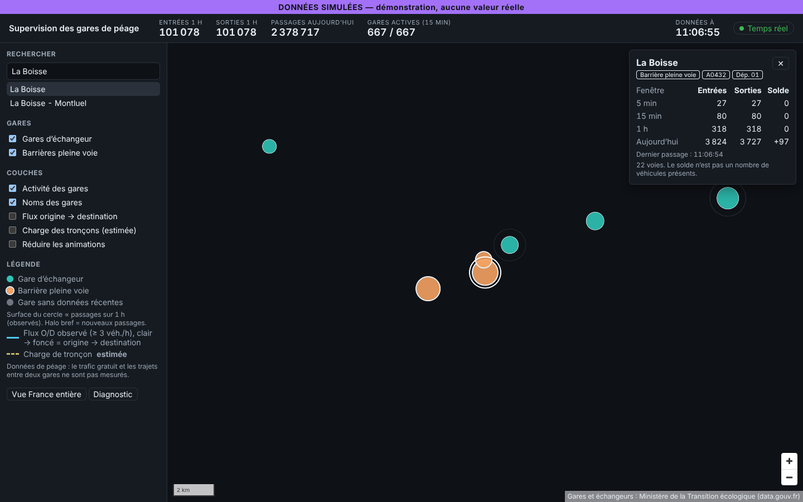
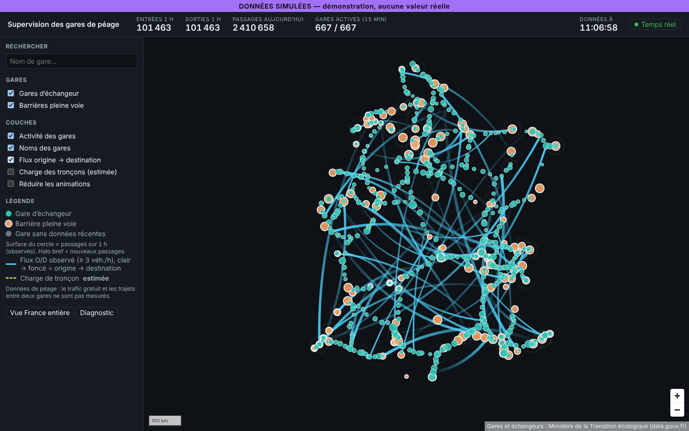

# Dossier de conception frontend et d'industrialisation — Phase 3/3

> Produit à partir de `prompts/phase-3-cartographie-rendu-industrialisation.md` et des dossiers des phases 1 et 2.
>
> Livrables vérifiés :
> - **frontend** `frontend/` : React 19, TypeScript strict, Vite 8, MapLibre GL JS 6 ; **43 tests unitaires** et **4 tests de bout en bout** (Playwright) passent ;
> - **chaîne cartographique** `cartographie/` : script et 4 tests ;
> - **Docker Compose** `compose.yaml`, testé : Kafka, PostgreSQL et nginx en bonne santé.

**Légende.** **[F]** fait vérifié, **[H]** hypothèse, **[D]** décision, **[Q]** question ouverte.



*Mode démonstration : flux simulé (bandeau violet), 667 gares logiques réelles, sans fond de carte car les serveurs de tuiles sont inaccessibles depuis l'environnement de test.*

---

## 1. Synthèse et décisions structurantes

| # | Décision | Justification |
|---|---|---|
| D20 | **MapLibre GL JS seul** pour le MVP ; deck.gl seulement si le plan de profilage (section 7.3) le justifie | 667 gares et ≤ 500 flux O/D : bien en dessous des volumes où deck.gl apporte un gain. Une seule pile WebGL, une seule gestion d'état de la carte |
| D21 | Fond **Protomaps (PMTiles)** auto-hébergé + couche **autoroutes OSM** dédiée (PMTiles produits par tippecanoe) ; métier en GeoJSON | Aucun serveur de tuiles : fichiers statiques lus par requêtes HTTP Range. Le style métier est indépendant du fond |
| D22 | **5 couches strictement séparées** : réception SSE → état (`StationStore`, tableaux typés hors React) → préparation géographique → boucle d'animation → rendu (`setFeatureState` par lots) | React ne se redessine qu'à chaque delta (≤ 1 Hz) et pour l'interface, jamais par événement Kafka |
| D23 | **Animation calculée à partir de l'horodatage de l'image**, avec des durées fixes, et une boucle qui s'arrête au repos | Indépendante du débit des messages et de la fréquence d'affichage ; CPU nul sans activité |
| D24 | **Impulsions** seulement sur passages nouveaux observés, avec un **délai de garde de 6 s** par gare et une opacité réduite à l'échelle nationale | Évite le clignotement permanent ; « élégant, informatif, non décoratif » |
| D25 | Estimé ≠ observé **dans le code du style** : charge des tronçons toujours en **tirets** et avec une rampe distincte, légende « estimée » | Respect de la règle transverse 3 |
| D26 | **Gestion d'état** : Zustand pour l'interface et store maison en colonnes typées pour les métriques | Zustand est léger (MIT, environ 1 Ko) ; les métriques n'ont pas à vivre dans React |
| D27 | Thème **sombre** de supervision, couleurs métier sarcelle/ambre **doublées d'un indice de forme** (contour épais pour les barrières pleine voie) | Salle de supervision, longue exposition ; distinguable en deutéranopie et protanopie |
| D28 | **nginx** sert à la fois le frontend et les tuiles ; il relaie l'API et le SSE (sans tampon, délai d'attente de 1 h) | Un seul point d'entrée, même origine : CSP stricte et cookie `SameSite=Strict` possibles |
| D29 | **Mode démonstration** = même chaîne de traitement que la production, alimentée par un `EventSource` simulé dans le navigateur, avec un **bandeau permanent** | Démonstration reproductible sans backend ; aucune confusion possible avec des données réelles |

---

## 2. Registre faits / hypothèses / décisions (mise à jour)

| # | Type | Énoncé | Statut |
|---|---|---|---|
| F20 | F | Le style produit est **valide** selon la spécification MapLibre, dans les trois configurations : hors ligne, démo avec polices, production (`validateStyleMin`, test) | Le test a détecté une vraie erreur pendant le développement : `zoom` imbriqué dans un produit |
| F21 | F | La démonstration affiche **plus de 600 gares** effectivement dessinées (`queryRenderedFeatures`, E2E), la recherche centre la carte sur la gare et la CSP nginx n'empêche ni le worker ni le rendu | E2E exécutés contre `vite preview` **et** contre le conteneur nginx |
| F22 | F | Taille du code JS gzip : application + MapLibre **376 Ko**, worker **147 Ko**, CSS 11 Ko ; référentiel GeoJSON 19 Ko | Mesuré sur le build de production |
| F23 | F | nginx : `206 Partial Content` sur `.pmtiles`, `application/geo+json` compressé en gzip, en-têtes CSP et `nosniff` sur toutes les routes, 502 propre sans backend | Vérifié dans Docker |
| F24 | F | MapLibre 6 ne trouve pas son worker une fois l'application empaquetée : il faut `setWorkerUrl` avec l'URL produite par Vite (`?worker&url`) | Corrigé ; c'est un piège à connaître |
| H20 | H | Le fond Protomaps France en z0–14 pèse quelques Go | **À mesurer** : le build n'a pas pu être téléchargé ici (accès réseau bloqué). Un z0–12 réduit fortement la taille si nécessaire |
| H21 | H | La règle « tronçon concédé = axe du référentiel à moins de 20 km d'un point de cet axe » reproduit correctement le statut concédé | À valider visuellement sur les sections libres d'axes concédés (par exemple l'A7 urbaine, l'A6 au nord d'Évry) |
| H22 | H | Le poste de référence de la salle de supervision dispose d'un GPU intégré récent et d'un écran ≥ 1920 × 1080 | Q20 |
| D20 à D29 | D | Voir section 1 | — |

---

## 3. Chaîne de données cartographiques (3.1)

### 3.1 Fond de carte et couches métier

| Option | Avantages | Limites | Verdict |
|---|---|---|---|
| **PMTiles (Protomaps)** | Un fichier, servi statiquement (Range), aucun serveur ; style sombre prêt à l'emploi ; code BSD-3, style CC0 | Pas de mise à jour incrémentale : on régénère l'extrait | **Fond** [D21] |
| OpenMapTiles + Martin / tileserver-gl | Schéma très répandu, serveur dynamique | Un service de plus à exploiter ; génération lourde (planetiler) | Alternative |
| GeoJSON direct | Simple, mises à jour en direct (`setData`) | Inadapté au-delà de quelques Mo | **Couches métier** (gares : 19 Ko gzip ; flux O/D) |

### 3.2 Chaîne reproductible (`cartographie/build.sh`, image `cartographie/Dockerfile`)

```
Protomaps build AAAAMMJJ ──pmtiles extract (bbox France, z0–14)──────────────▶ out/tiles/france.pmtiles
basemaps-assets ──fonts Noto Sans Regular/Medium + sprites v4───────────────▶ out/basemaps-assets/
Geofabrik france-latest.osm.pbf
  └─ osmium tags-filter w/highway=motorway,motorway_link
     └─ osmium export geojsonseq
        └─ prepare_motorways.py ── découpe aux jonctions, segmentId, ref, concede ──▶ segments.geojsonseq
                                └─ graphe orienté (longueur, vitesse) ──────────────▶ out/graph/graph-AAAAMMJJ.json
           └─ tippecanoe (z4–14, simplification 4) ─────────────────────────────────▶ out/tiles/motorways.pmtiles
```

- **`prepare_motorways.py`** (4 tests unitaires **[F]**) :
  - coupe les voies aux sommets où une bretelle se raccorde ;
  - attribue un `segmentId` stable dans une version donnée (`w<idOSM>-<n>`) ;
  - normalise les références (`A 7;E 15` → `A7`, `A0007N` → `A7`) ;
  - pose le drapeau `concede` (H21) ;
  - produit le **graphe d'affectation** consommé par le module `assignment` de la phase 2.
- **Rattachement des gares au tracé** : contrôle en phase d'intégration, écart gare → tronçon le plus proche < 500 m (critère de la phase 2, section 5.4). Les écarts sont listés dans la vue diagnostic.
- **Reprojection** Lambert 93 → WGS84 : déjà faite par `scripts/export_geojson.py` (phase 1 vérifiée **[F]**).
- **Polices et sprites auto-hébergés** (`/basemaps-assets/`) : aucun CDN tiers. **Sans polices, le style retire automatiquement les couches de texte** pour rester valide (mode démonstration hors ligne).
- **Exécution [F]** : la chaîne a été exécutée de bout en bout en octobre 2026 (fond Protomaps z0–12, 61 367 tronçons, graphe de 58 974 nœuds, polices et sprites auto-hébergés) ; sources, mesures et écarts dans `increment-4.md`, section 4. L'image Docker de la chaîne n'a pas pu être construite dans l'environnement de test.

### 3.3 Attributions et licences

| Donnée | Licence | Affichage |
|---|---|---|
| Fond Protomaps (données OSM) | ODbL (données), CC0 (style), BSD-3 (code) | « Protomaps © OpenStreetMap », dans le contrôle d'attribution |
| Couche autoroutes (OSM) | ODbL | « © OpenStreetMap contributors (ODbL) » (source `motorways`) |
| Gares et échangeurs RRNc | ODC-By / Licence Ouverte | « Gares et échangeurs : Ministère de la Transition écologique (data.gouv.fr) », toujours affiché |
| Polices Noto | SIL OFL 1.1 | Fichier de licence conservé dans `basemaps-assets` |

Rappel ODbL (phase 1, Q10) : le **graphe dérivé d'OSM** est une base dérivée. S'il est diffusé hors de l'organisation, il doit l'être sous ODbL.

---

## 4. Architecture frontend (3.2)

### 4.1 MapLibre seul ou avec deck.gl **[D20]**

| Critère | MapLibre seul (retenu) | MapLibre + deck.gl |
|---|---|---|
| Volumes métier | 667 points, ≤ 500 arcs, ≤ 20 000 tronçons à colorer : largement dans les capacités | Conçu pour 10⁵ à 10⁶ objets |
| Animation | `feature-state` par lots, au plus 30 écritures par seconde | Attributs GPU, animations interpolées sur la carte graphique |
| Coût | Un seul contexte WebGL ; ≈ 523 Ko gzip au total **[F22]** | +≈ 300 à 400 Ko gzip, superposition de deux moteurs (ordre des couches, sélection) |
| Bascule | — | Si un critère du plan de profilage (section 7.3) échoue |

### 4.2 Gestion d'état **[D26]**

| Option | Retenu pour | Raison |
|---|---|---|
| **Store maison en colonnes** (`StationStore`, `Float64Array`) | Métriques des gares | Accès O(1) par index (= id de feature), aucune allocation par delta, notifications ≤ 1 Hz |
| **Zustand** (MIT) | Interface : sélection, filtres, couches, statuts, flux O/D | `subscribe` hors React (le contrôleur de carte n'est jamais re-rendu) |
| Redux Toolkit | — | Cérémonie inutile ici |
| Web Worker pour le parsing | — (critère de bascule) | Messages ≤ 130 Ko/min : le JSON est analysé en < 1 ms. Bascule si le temps de parsing dépasse 4 ms au 95e centile (section 7.3) |

### 4.3 Les cinq couches et leurs fichiers

| Couche | Fichier(s) | Fréquence |
|---|---|---|
| 1. Réception SSE, reconnexion, resynchronisation | `realtime/streamClient.ts`, `realtime/protocol.ts`, `realtime/runtime.ts` | messages |
| 2. État métier | `realtime/syncEngine.ts` (séquences et epochs), `state/stationStore.ts`, `state/uiStore.ts` | ≤ 1 Hz (deltas), 0,1 Hz (O/D) |
| 3. Préparation géographique | `map/scales.ts`, `map/odGeometry.ts`, `map/referentiel.ts` | à chaque delta |
| 4. Boucle d'animation | `animation/frameLoop.ts`, `animation/stationAnimator.ts` | images, **seulement s'il y a une animation en cours** |
| 5. Rendu | `map/stationLayerRenderer.ts` (lots de `setFeatureState`), `map/layers.ts`, `map/style.ts`, `map/mapController.ts` | ≤ 30 Hz (qualité 0), ≤ 4 Hz (qualité 2) |

### 4.4 Synchronisation côté client (protocole de la phase 2, section 8)

- **Snapshot**, puis deltas `seq + 1`. Un **delta déjà appliqué est ignoré** (rejeu après une reconnexion par `Last-Event-ID`).
- Si le client détecte un **trou**, un **changement d'epoch** ou un **delta avant snapshot**, il ouvre une **nouvelle connexion sans `Last-Event-ID`** et reçoit un snapshot (tests `syncEngine`, `streamClient`).
- Une **coupure transitoire** est laissée à `EventSource`, qui renvoie `Last-Event-ID` et reçoit les deltas manquants. Une **connexion fermée** déclenche un backoff exponentiel avec aléa (0,75 s → 30 s). Un **silence de plus de 45 s** (heartbeat absent) déclenche une reconnexion.
- `freshness: CATCHING_UP` : le bandeau passe à l'orange « Rattrapage ». *Évolution prévue* : suspendre les impulsions pendant le rattrapage, pour ne pas animer un rattrapage comme une activité réelle.
- `referentielChanged` : rechargement de la page au MVP (le référentiel change rarement). Rechargement à chaud au-delà.

---

## 5. Moteur d'animation (3.3)

### 5.1 Représentations

| Représentation | Zoom | Donnée | Statut | Implémentation |
|---|---|---|---|---|
| Cercle proportionnel (surface ∝ passages sur 1 h) | tous ; rayon × 0,35 (z4) → × 1,6 (z13) | `last1h` entrées + sorties | **Observé** | `radiusFor` (racine carrée ; la référence est le **95e centile**, pas le maximum) ; transition de 800 ms |
| Halo bref et amorti | tous ; opacité × 0,2 à z5, × 0,8 à z8 et au-delà | hausse du cumul du jour depuis la mise à jour précédente | **Observé** | `pulse` (1,4 s, décroissance quadratique, **délai de garde de 6 s**, intensité log, plancher 0,25) |
| Gare sans données récentes | tous | `freshness.staleStations` | Observé (absence) | gris, opacité 0,5 |
| Arcs origine → destination | tous ; **60 plus gros flux** sans sélection, **tous les flux de la gare sélectionnée** sinon | `od` (≥ 3 véh./h) | **Observé** | courbe de Bézier courbée à droite du sens de parcours, dégradé clair → foncé de l'origine vers la destination, largeur ∝ racine carrée du volume |
| Charge des tronçons | ≥ z4, désactivée par défaut | `segments` | **ESTIMÉ** | `feature-state.load` sur la couche `motorways`, **tirets** + rampe de type cividis |
| Particules le long des tronçons | — | — | — | **Écartées** : elles suggéreraient des véhicules suivis, et aucun ne l'est (règle 3) |
| Agrégation à petite échelle | z < 6 | — | — | Atténuation des halos ; regroupement de type `cluster` reporté (incompatible avec `feature-state`) : à réévaluer si la densité gêne en usage réel |



### 5.2 Garanties temporelles **[F]** (tests)

- Valeur affichée = f(horodatage de l'image) : **la même valeur à t = 500 ms, que l'on ait calculé 31 images ou une seule** (test `produces the same value whatever the frame rate`).
- Nouvelle cible en cours de transition : on repart de la valeur affichée, **sans saut**.
- **La boucle s'arrête** quand plus rien n'est animé, et un delta la relance (`FrameLoop.wake`).

### 5.3 Dégradation et mouvement réduit

| Niveau | Déclenchement | Effet |
|---|---|---|
| 0 | — | Complet ; écritures vers la carte toutes les 33 ms au plus |
| 1 | 3 fenêtres consécutives de 30 images au-dessus de 20 ms en moyenne | Halos supprimés ; écritures toutes les 50 ms |
| 2 | Idem au niveau 1 | Écritures toutes les 250 ms |
| Retour | 60 fenêtres sous le budget (≈ 30 s) | Remonte d'un niveau |
| `prefers-reduced-motion` ou case « Réduire les animations » | Préférence système ou choix de l'utilisateur | Valeurs appliquées immédiatement, **aucune impulsion** |

Le niveau courant est affiché dans la vue Diagnostic.

---

## 6. Interface et direction artistique (3.4)

### 6.1 Disposition (desktop prioritaire)

```
┌──────────────────────────── DONNÉES SIMULÉES (mode démo uniquement) ──────────────────────────────┐
├─ Supervision │ Entrées 1 h │ Sorties 1 h │ Passages aujourd'hui │ Gares actives │  Données à hh:mm:ss  ● Temps réel ┤
├───────────────┬───────────────────────────────────────────────────────────────────────────────────┤
│ Rechercher    │                                                              ┌ Détail gare ────┐   │
│ [Nom de gare] │                                                              │ Nom  [type][axe] │   │
│ Gares         │                          CARTE                               │ 5 min/15 min/1 h │   │
│ ☑ échangeur   │                     (≈ 80 % de l'écran)                      │ aujourd'hui      │   │
│ ☑ pleine voie │                                                              │ solde, fraîcheur │   │
│ Couches       │                                                              └─────────────────┘   │
│ ☑ activité    │  ┌ Diagnostic ─────────┐                                                          │
│ ☐ O/D ☐ tronç.│  │ connexion, retard,  │                                                 [+][−]   │
│ Légende       │  │ resync, inconnues…  │                                                          │
│ [France][Diag]│  └─────────────────────┘                           attribution OSM / data.gouv     │
└───────────────┴───────────────────────────────────────────────────────────────────────────────────┘
```

| Vue | Mise en œuvre |
|---|---|
| France entière | Cadrage initial sur la France (bouton « Vue France entière ») |
| Régionale | Zoom 7 à 9 : les halos deviennent pleinement visibles, les libellés de gare apparaissent dès z8 |
| Gare | Recherche (clavier) ou clic → zoom 11 + panneau de détail ; flux O/D limités à cette gare |
| Diagnostic | Connexion, fraîcheur, retard du watermark et du consommateur, gares périmées, resynchronisations, identifiants inconnus, version d'état, qualité de rendu |

### 6.2 Direction artistique (`map/theme.ts`, `styles.css`)

| Élément | Règle |
|---|---|
| Fond | `#0E1116`, fond Protomaps « dark » en français |
| Autoroutes | Concédées `#5B6578` ; non concédées `#3A4150` plus discrètes ; bordure sombre ; largeur exponentielle 0,6 px (z4) → 10 px (z15) ; numéros (`ref`) le long des lignes dès z6 |
| Gares | Échangeur sarcelle `#2EC4B6`, contour fin ; **pleine voie ambre `#F4A261`, contour épais** (forme + couleur) ; sélection : anneau blanc |
| Flux | O/D bleu `#4CC9F0` (observé, trait plein) ; tronçons : rampe de type cividis `#2B3A55` → `#F2D45C`, **en tirets** (estimé) |
| Typographie | Inter / Noto Sans ; chiffres **tabulaires** (pas de tremblement des indicateurs) ; carte : Noto Sans Regular, halo sombre de 1,5 px |
| Densité | Libellés de gare dès z8, `text-optional` (pas d'éviction des cercles) ; halos atténués avant z6 ; 60 arcs maximum à l'échelle nationale |
| Accessibilité | Contrastes texte ≥ AA (axe-core, aucune violation grave ou critique **[F]**) ; contrôles au clavier ; `role=status` + `aria-live` pour l'état du flux ; la recherche remplace le clic sur la carte pour le clavier ; mouvement réduit |
| Responsive | En dessous de 900 px : carte au-dessus, panneau en dessous ; lisible mais non prioritaire |



---

## 7. Performance (3.5)

### 7.1 Scénarios (paramètres du simulateur de la phase 2 et du `DemoEventSource`)

| Paramètre | Nominal | Pointe | Stress |
|---|---|---|---|
| Gares | 667 | 667 | 2 000 (référentiel synthétique) |
| Deltas par seconde (gares modifiées par delta) | 1 (≈ 110) | 1 (≈ 400) | 1 (2 000) |
| Tronçons colorés | 0 | 5 000 | 20 000 |
| Flux O/D | 60 affichés / 500 reçus | idem | 500 affichés |
| Clients SSE | 10 | 50 | 500 |
| Durée | 8 h | 1 h | 30 min |

### 7.2 Objectifs mesurables (poste de référence H22)

| Mesure | Objectif | Outil |
|---|---|---|
| Première carte interactive (cache vide, réseau local) | ≤ 2,5 s | Lighthouse / `performance.mark` |
| JS initial gzip | ≤ 600 Ko (**523 Ko mesurés [F22]**) | build Vite |
| Latence Kafka → écran | ≤ 3 s au 95e centile (cible de la phase 2) | horodatage `sentAt` vs rendu (`performance.now`), exposé dans le diagnostic |
| Fluidité | 5e centile ≥ 50 images/s pendant les animations en scénario pointe ; temps de script ≤ 8 ms par image | Chrome DevTools Performance / `PerformanceObserver` (`long-animation-frame`) |
| CPU au repos (aucun delta) | ≈ 0 (boucle arrêtée) | Gestionnaire de tâches, profil de 60 s |
| Mémoire sur 8 h | Croissance ≤ 10 % après la première heure | `performance.measureUserAgentSpecificMemory`, instantané de tas |
| Resynchronisation (snapshot) | ≤ 1 s, de la réception à l'affichage | trace E2E |

### 7.3 Plan de profilage et critères de bascule vers deck.gl

1. Banc Playwright + Chrome DevTools Protocol (traces) sur le poste de référence, scénarios de la section 7.1, 3 essais chacun.
2. Mesures : durée des images, temps passé dans `setFeatureState` / `setData`, temps de parsing JSON, GC.
3. **Bascule vers deck.gl** si, en scénario *pointe*, l'**un** des critères suivants persiste après optimisation MapLibre (lots, fréquence d'écriture, réduction des couches) :
   - 5e centile < 50 images/s ;
   - > 4 ms par image passées à pousser `feature-state` ;
   - coloration de 20 000 tronçons > 50 ms par mise à jour.

   **Périmètre de bascule** : seulement les couches animées (gares, tronçons). Le fond et les libellés restent dans MapLibre (`MapboxOverlay` en mode entrelacé).
4. **Bascule du parsing vers un Web Worker** si le parsing dépasse 4 ms au 95e centile.

---

## 8. Tests et validation (3.6)

| Niveau | Contenu | Outils | État |
|---|---|---|---|
| Unitaires frontend | Protocole (5 cas de rejet) ; `StationStore` (incréments, minuit, ids inconnus, notifications) ; `SyncEngine` (contiguïté, rejeu ignoré, trou, epoch, delta sans snapshot) ; `StreamClient` (routage, resynchronisation = nouvelle connexion, erreur transitoire, backoff, heartbeat) ; animateur (indépendance à la fréquence d'images, reprise sans saut, arrêt, délai de garde, mouvement réduit) ; `FrameLoop` (arrêt au repos, dégradation et retour) ; échelles ; **validité du style en 3 configurations** ; arcs O/D ; pont vers la carte (lots, fréquence plafonnée, halos supprimés en qualité 1) | Vitest 5, jsdom, style-spec MapLibre | ✅ **43 tests** |
| Bout en bout | Rendu réel en WebGL (SwiftShader) : > 600 gares dessinées, bandeau simulé, état « Temps réel », **aucune erreur console** ; recherche au clavier → zoom + détail ; couche O/D ; accessibilité axe-core | Playwright 1.64, @axe-core/playwright | ✅ **4 tests**, contre `vite preview` **et** contre le conteneur nginx (CSP active) |
| Chaîne cartographique | Normalisation des références, découpe aux jonctions, graphe, drapeau `concede`, voie bidirectionnelle | `unittest` | ✅ 4 tests |
| Régression visuelle | Captures de référence (vue France, gare, flux) avec un **générateur à graine fixe** ; seuil de 0,2 % de pixels | `toHaveScreenshot` | à faire (le `DemoEventSource` accepte déjà un `random` injectable) |
| Exactitude des positions | Écart gare logique ↔ centroïde des points reprojetés = 0 (même calcul) ; gare ↔ tracé OSM < 500 m | script + diagnostic | à faire (dépend du tracé) |
| Résolutions | 1280 × 800, 1920 × 1080, 2560 × 1440, 390 × 844 | projets Playwright | à faire |
| Charge et fluidité | Section 7 | Playwright + CDP | à faire (poste de référence) |

Tout s'exécute sans GPU : `CHROMIUM_PATH=… npx playwright test` (Chromium préinstallé), ou `E2E_BASE_URL=http://localhost:8080` pour viser un déploiement.

---

## 9. Déploiement (3.7)

### 9.1 Docker Compose (`compose.yaml`) **[F]**

| Profil | Services | Usage | Vérifié |
|---|---|---|---|
| `demo` | `frontend` (nginx, build `MODE=demo`), lecture seule, tmpfs | Démonstration : http://localhost:8080 | ✅ en bonne santé, E2E passés contre lui |
| `infra` | `kafka` (KRaft, rétention 72 h), `kafka-init` (topics `toll-events` × 6 partitions, `toll-events.rejected`), `postgres` 17 | Développement du backend en local (`localhost:29092`, `localhost:5432`) | ✅ en bonne santé, topics créés |
| `full` | `backend`, `simulator`, `frontend-live` (production) + `kafka`, `postgres` ; `keycloak`, `prometheus`, `grafana` à l'incrément 5 | Démonstration de bout en bout | ✅ incrément 1 (voir `docs/increment-1.md`) |

- Secrets : `POSTGRES_PASSWORD` dans `.env` (non versionné, modèle `.env.example`). Compose **refuse de démarrer** sans ce mot de passe.
- Images : versions figées (`node:24-alpine`, `nginx:1.29-alpine`, `apache/kafka:4.1.0`, `postgres:17-alpine`), build multi-étapes.
- Tuiles et assets : montés depuis `cartographie/out/` (vides en démonstration hors ligne).
- *Limite de l'environnement de test* : `npm ci` dans `docker build` échoue derrière le proxy TLS du conteneur de test (certificat intercepté). L'image d'exécution a été vérifiée avec le build local. Aucun impact attendu sur un poste ou une CI standards.

### 9.2 nginx (`frontend/nginx.conf`)

- `add_header` est **uniquement au niveau serveur** : un `add_header` dans une `location` annule les en-têtes hérités. Le défaut a été constaté puis corrigé ; les durées de cache passent par `expires`.
- CSP : `default-src 'self'; worker-src 'self' blob:; style-src 'self' 'unsafe-inline'` (les styles inline des pastilles de légende et de MapLibre l'exigent) ; `connect-src 'self'`.
- `/tiles/` : HTTP Range, pas de gzip ; `/assets/` : cache d'un an (fichiers horodatés par Vite) ; `index.html` : `no-cache`.
- `/api/v1/stream` : `proxy_buffering off`, `proxy_read_timeout 1h`, HTTP/1.1 sans `Connection` ; résolution DNS à la requête (nginx démarre sans le backend).

### 9.3 Production

- Proxy inverse TLS (Caddy ou Traefik, Apache-2.0 / MIT) devant nginx, **HTTP/2 obligatoire** (limite de 6 connexions HTTP/1.1, phase 2, section 8.1).
- Cache CDN ou proxy pour `/tiles/` (fichiers immuables par version : `france-AAAAMMJJ.pmtiles`).
- Variables de build : `VITE_BASEMAP_URL=pmtiles:///tiles/france.pmtiles` (même origine, résolue à l'exécution), `VITE_MOTORWAYS_URL`, `VITE_GLYPHS_URL`, `VITE_SPRITE_URL` (`frontend/.env`).

---

## 10. Arborescence et roadmap (3.8)

### 10.1 Dépôt (monodépôt) **[D]**

Un seul dépôt : un seul versionnement pour le contrat SSE, le référentiel et le style ; une CI unique. Découpage en plusieurs dépôts seulement si des équipes distinctes livrent à des rythmes différents.

```
autoroutes/
├── compose.yaml, .env.example
├── docs/                         dossiers phases 1–3, captures
├── prompts/                      prompts des 3 phases
├── referentiel/                  alias, gares logiques (proposition), cas à arbitrer
├── scripts/                      analyse_referentiel.py, export_geojson.py
├── cartographie/                 build.sh, prepare_motorways.py (+ tests), Dockerfile
├── backend/                      Spring Boot 4.1 (phase 2)
└── frontend/
    ├── Dockerfile, nginx.conf, playwright.config.ts, vite.config.ts, eslint.config.js
    ├── public/demo/              stations.geojson, interchanges.geojson
    ├── e2e/demo.spec.ts
    └── src/
        ├── realtime/             protocol, syncEngine, streamClient, runtime
        ├── state/                stationStore, uiStore
        ├── animation/            easing, stationAnimator, frameLoop
        ├── map/                  theme, layers, style, scales, odGeometry, referentiel, stationLayerRenderer, mapController
        ├── demo/                 demoEventSource (flux simulé)
        └── ui/                   TopBar, SidePanel, StationDetail, DiagnosticPanel, MapView
```

### 10.2 Roadmap par incréments

| Incrément | Contenu | Dépendances | Risques | Critères d'acceptation |
|---|---|---|---|---|
| **0. Socle données** ✅ en grande partie | Référentiel, alias, GeoJSON, frontend démo, Compose infra | Validation métier des 161 points à arbitrer | Regroupement contesté | Table validée ; 100 % des gares positionnées |
| **1. MVP temps réel** ✅ sauf chaîne cartographique | Backend : listener Kafka, écrivain unique, SSE, API référentiel, checkpoint ; chaîne cartographique exécutée ; profil `full` ; simulateur | **Q14** (noms réels du topic), Q3, accès réseau aux sources de tuiles | H7 (noms) ; taille du fond (H20) | Bout en bout sur données simulées puis réelles ; latence ≤ 3 s au 95e centile ; quarantaine < 1 % |
| **2. Historique** ✅ (`docs/increment-2.md`) | Agrégats persistés, séries dans le détail de gare, comparaison J/J-7, mode relecture (lecture, pause, vitesse) | Q5 (rétention) | Volumes `od_hour` | Requête sur 13 mois < 1 s ; relecture fluide ×60 |
| **3. Flux O/D** ✅ ([détail](increment-3.md)) | Diffusion `od` réelle, seuil RGPD, filtres par axe et département | Incrément 1 | Lisibilité nationale | Cohérence Σ O/D = sorties − manquants (± 0,5 %) |
| **4. Charge estimée des tronçons** 🟡 ([détail](increment-4.md)) | Graphe OSM → module `assignment`, couche `segments-load`, mention « estimé » | Incrément 3, Q10 (ODbL), H21 | Contestation de l'affectation | Validation métier sur 3 axes |
| **5. Industrialisation** 🟡 ([détail](increment-5.md)) | OIDC Keycloak, Prometheus/Grafana, régression visuelle, banc de performance, durcissement | Q4, Q20 | Bascule vers deck.gl si critère 7.3 | Section 11 entièrement vérifiée |

---

## 11. Critères d'acceptation globaux

| Critère | État | Preuve / reste à faire |
|---|---|---|
| Réseau autoroutier crédible et lisible | 🟢 | Rendu vérifié avec les vraies tuiles OSM et le fond Protomaps (captures, E2E réels verts) ; reste le jugement visuel sur le poste de référence |
| Toutes les gares correctement positionnées | 🟢 | 667 gares logiques reprojetées, > 600 dessinées dans l'E2E ; contrôle gare ↔ tracé : **662 sur 667 à moins de 500 m** (médiane 13 m), les 5 autres sur routes nationales ; reste l'arbitrage des 161 points |
| Mise à jour sans rechargement complet | 🟢 | Deltas → `setFeatureState` par lots ; React à ≤ 1 Hz |
| Fluidité sous la charge cible | 🟡 | Architecture et dégradation en place ; côté serveur, 400 clients SSE mesurés (incrément 5) ; **fluidité d'affichage à mesurer sur le poste de référence** (section 7, Q20) |
| Flux cohérents avec les données disponibles | 🟢 | Seuls des agrégats observés ; O/D filtrés au seuil ; pas de particules fictives |
| Observé distingué de l'estimé | 🟢 | Tirets + légende « estimée » ; `nature` dans le protocole ; règle encodée dans le style |
| Resynchronisation après interruption | 🟢 | Tests du client (trou, epoch, heartbeat, backoff) ; reprise par `Last-Event-ID` et changement d'epoch vérifiés avec Kafka et PostgreSQL réels (`SupervisionIT`) ; banc de 400 clients sans resynchronisation (incrément 5) |
| Aucune dépendance propriétaire | 🟢 | Pile intégralement open source (section 12), aucune clé d'API |
| Reproductibilité | 🟢 | Versions figées, lockfile, Compose, scripts ; démonstration hors ligne |
| Licences documentées | 🟢 | Sections 3.3 et 12, attributions affichées sur la carte |
| Accès authentifié et rôles | 🟢 | Connexion OIDC (Keycloak) vérifiée de bout en bout, 401 sans session, rôles VIEWER et ADMIN, CSRF sur l'administration, audit et budget des requêtes O/D (incrément 5) ; reste : Keycloak de production |

---

## 12. Licences de la pile frontend et outillage

| Composant | Rôle | Licence | Alternative |
|---|---|---|---|
| React 19 / React DOM | Interface | MIT | Preact |
| MapLibre GL JS 6.15 | Rendu cartographique | BSD-3 | OpenLayers (BSD-2) |
| pmtiles 4.5 / @protomaps/basemaps 5.7 | Lecture PMTiles, style du fond | BSD-3 | tileserver-gl |
| Zustand 5 | État d'interface | MIT | Jotai |
| Vite 8 / TypeScript 5.9 | Build, typage strict | MIT / Apache-2.0 | — |
| Vitest 5, jsdom, Testing Library, Playwright 1.64, axe-core | Tests | MIT / MIT / MIT / Apache-2.0 / MPL-2.0 | — |
| ESLint 10 + typescript-eslint (strictTypeChecked) | Qualité | MIT / MIT | Biome |
| nginx 1.29 | Service statique, proxy | BSD-2 | Caddy |
| osmium-tool, tippecanoe, go-pmtiles | Chaîne cartographique | GPL-3.0 (outil), BSD-2, BSD-3 | planetiler (Apache-2.0) |
| Apache Kafka 4.1, PostgreSQL 17 | Infrastructure | Apache-2.0, PostgreSQL | — |

osmium-tool est sous GPL-3.0, mais il n'est utilisé **que comme outil de build** : il n'est ni distribué ni lié au produit.

---

## 13. Risques et questions ouvertes

| # | Risque / question | Impact | Mesure |
|---|---|---|---|
| R20 | Taille du fond PMTiles z0–14 (H20) | Stockage, temps de déploiement | Mesurer ; z0–12 + surcouche locale si nécessaire |
| R21 | Approximation du drapeau `concede` (H21) | Couleur erronée sur quelques sections | Revue visuelle ; table d'exceptions versionnée |
| R22 | Évolutions de MapLibre 6 (worker, API) | Régressions à la mise à jour | Tests de style + E2E de rendu déjà en place |
| R23 | Lisibilité nationale avec les vrais flux O/D | Surcharge | 60 arcs maximum, filtre par gare ; agrégation par axe à étudier |
| Q14 | ~~Noms de gare réels du topic~~ | — | **Répondue** : même liste que le référentiel |
| Q20 | Poste de référence (GPU, écran) de la salle de supervision | Objectifs de la section 7 | Nouvelle |
| Q21 | Accès réseau du poste de build aux sources Protomaps / Geofabrik / GitHub (ou miroir interne) | Exécution de `cartographie/build.sh` | Nouvelle |
| Q22 | Mode relecture historique au MVP ou à l'incrément 2 ? | Périmètre de l'interface | Inchangé depuis Q11 : incrément 2 proposé |
